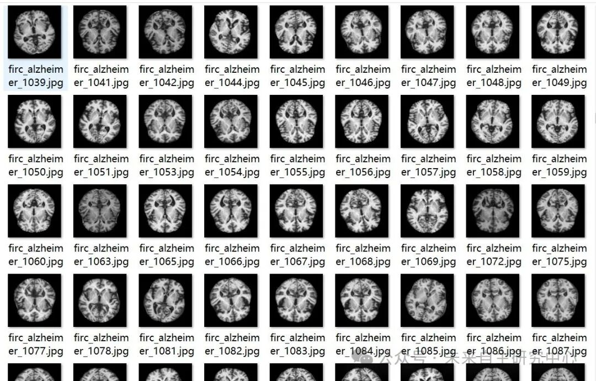
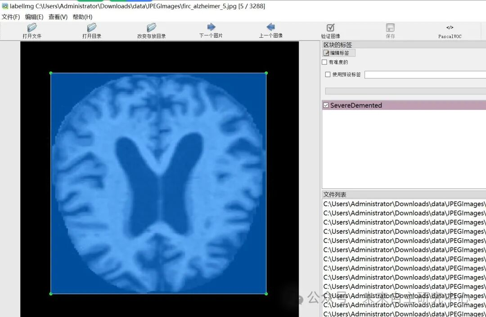

# VOC+YOLO format: Alzheimer's Disease Severity Detection Dataset with 3288 Images in 5 Categories

Dataset format: Pascal VOC format + YOLO format (txt file without split path, only containing jpg images and corresponding VOC format xml files and yolo format txt files)

Number of images (number of jpg files): 3288

Number of annotations (number of xml files): 3288

Number of annotations (number of txt files): 3288

Label category count: 5

Label category names (Note that the order of yolo format categories does not correspond to this, but is based on the labels folder's classes.txt): ["Mild Demented", "Moderate Demented", "Non Demented", "Severe Demented", "Very Mild Demented"]

Number of boxes labeled in each category:

MildDemented frame count = 785

ModerateDemented Frame Count = 713

NonDemented Frames = 606

SevereDemented Frame Count = 680

VeryMildDemented Frames = 504

Total frame count: 3288

Using labelImg:

Annotation rules: Draw a rectangle around the category.

Important Notice: No

Special : This dataset does not guarantee the accuracy or precision of the trained models or weight files. The dataset is provided with accurate and reasonable annotations only.

Image Preview:

Annotation example:

## Payment

Here is a pay link on Stripe ( https://buy.stripe.com/3cs8yP7sY87d0vu9AB ). Please contact me lonlonago@foxmail.com after funding $89, and I will send you a complete data files , thank you!

